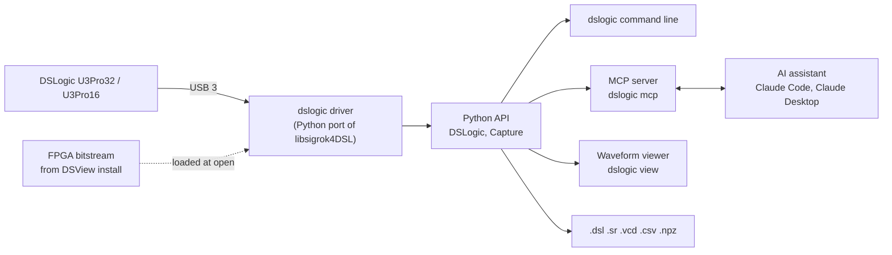

# dslogic-tool

Python driver, CLI and MCP server for DreamSourceLab DSLogic U3Pro32/U3Pro16 logic analysers: capture, trigger, decode SPI/I2C/UART, save DSView .dsl files, and let an AI assistant (Claude, etc.) drive captures over the Model Context Protocol.

## What is this?

**A Python replacement for DSView's capture side: the same analyser, the same USB protocol and the same `.dsl` files, driven from a script, a command line or an AI assistant.**

- Works like a printer driver: DSView's own C driver (libsigrok4DSL), ported line by line to Python, talks to the analyser over USB.
- sigrok and PulseView do not support the U3 series; this tool does.
- Captures are saved as DSView `.dsl` files with channel names, colours and decoders, so they open in DSView ready to read.
- An MCP server lets an AI assistant such as Claude Code capture, decode and measure on its own.
- Pure Python 3.14+, Windows first, Linux and WSL2 too.

## The big picture



- Solid arrow = data. Dashed arrow = a file read once when the analyser opens.
- The Python API does the work; the command line, the MCP server and the viewer are thin layers on top of it.
- The FPGA bitstream is DreamSourceLab's and is not in this repository (see [FPGA bitstream](#fpga-bitstream)).

## Install

### Windows

- Install Python 3.14 or newer from python.org.
- Install [DSView](https://www.dreamsourcelab.com/download/) once and check it sees the analyser. Its installer binds the WinUSB driver that libusb needs, and its `res` folder holds the FPGA bitstream.
- Close DSView before using this tool: only one program can hold the analyser.
- In the project folder:

```bat
py -3.14 -m venv .venv
.venv\Scripts\activate
pip install -e .[view,mcp,test]
dslogic scan
```

- Extras: `view` = viewer (pyqtgraph, PySide6, matplotlib), `mcp` = MCP server (mcp 2.x SDK), `test` = pytest and everything above.
- If `dslogic scan` lists the analyser but opening fails with "no WinUSB/libusb driver bound", bind WinUSB to it with [Zadig](https://zadig.akeo.ie/). DSView keeps working with WinUSB.

### Linux

```sh
uv venv --python 3.14 .venv && . .venv/bin/activate
uv pip install -e .[view,mcp,test]
echo 'SUBSYSTEM=="usb", ATTRS{idVendor}=="2a0e", MODE="0666"' | sudo tee /etc/udev/rules.d/60-dslogic.rules
sudo udevadm control --reload && sudo udevadm trigger      # let normal users open the analyser
```

### WSL2

- A native Windows Python is simpler and faster; WSL can start it directly (see [MCP server](#mcp-server)).
- To use the analyser inside WSL instead, attach it from Windows:

```powershell
usbipd list
usbipd attach --wsl --busid <BUSID>
```

### FPGA bitstream

- The analyser needs DreamSourceLab's FPGA bitstream, `DSLogicU3Pro32.bin` or `DSLogicU3Pro16.bin`, loaded at every open.
- These files belong to DreamSourceLab and are **not included in this repository**. Get them from a [DSView](https://www.dreamsourcelab.com/download/) install (its `res` folder) or from the [DSView repository](https://github.com/DreamSourceLab/DSView/tree/master/DSView/res).
- With DSView installed in its default place, nothing else is needed. The tool looks in this order:
  1. `firmware_dir=` in Python, `--firmware-dir` on the command line
  2. the folder in the `DSLOGIC_RES` environment variable
  3. `dslogic/res/` in this package (git ignores `.bin` files there)
  4. DSView's install: `C:\Program Files\DSView\res` (or `Program Files (x86)`); `/usr/share/DSView/res`, `/usr/local/share/DSView/res` or `/mnt/c/Program Files/DSView/res` on Linux and WSL
- The analyser's USB firmware is in its own flash, so nothing else is uploaded.

## Three ways to use it

### Python

```python
from dslogic import DSLogic, SPI

with DSLogic.open() as la:                  # loads the FPGA on first use
    la.samplerate = "250M"
    la.duration = "5ms"
    la.threshold = 1.65                     # volts: half of a 3.3 V supply
    la.enable_channels([0, 1, 2, 3])
    la.set_names({0: "CS", 1: "SCLK", 2: "MISO", 3: "MOSI"})
    la.set_trigger("CS", "falling")
    la.trigger_position = 10                # % of the capture kept before the trigger
    la.add_decoder(SPI(clk="SCLK", mosi="MOSI", miso="MISO", cs="CS"))
    cap = la.capture(timeout=10)

for t in cap.decoders[0].transfers(cap):
    print(cap.time_of(t.start), t.text)     # seconds relative to the trigger
cap.save("spi.dsl")                         # opens in DSView with names and decoder
```

- More in `examples/`: SPI capture, UART streaming, multi-stage trigger.

### Command line

```bat
dslogic capture -r 250M -t 5ms -c 0-3 --name 0=CS,1=SCLK,2=MISO,3=MOSI --threshold 1.65 --trigger CS=falling --pos 10 --decoder spi:clk=SCLK,mosi=MOSI,miso=MISO,cs=CS -o spi.dsl -p
dslogic decode spi.dsl
dslogic view spi.dsl
```

- While a capture runs, **Ctrl-X** stops it and saves what was captured; **Ctrl-C** stops the analyser and exits without saving.

### MCP server

- `dslogic mcp` runs the tool as an [MCP](https://modelcontextprotocol.io) (Model Context Protocol) server over stdio, so an AI assistant can list analysers, capture, decode, measure and render waveforms into the chat.
- Needs the `mcp` extra. Register it with Claude Code on Windows, or on Linux with the analyser attached:

```sh
claude mcp add dslogic -- <venv python> -m dslogic mcp
```

- Claude Code in WSL with the analyser on Windows (WSL starts the Windows Python):

```sh
claude mcp add dslogic -- /mnt/c/<path>/dslogic-tool/.venv/Scripts/python.exe -m dslogic mcp
```

- An MCP client stops waiting after its tool timeout (Claude Code: `MCP_TOOL_TIMEOUT`, in ms). Set it above the longest capture `timeout` in use.

## Reference

<ol>
<li>
<details>
<summary>Settings</summary>

| Setting | API | Notes |
|---|---|---|
| Sample rate | `la.samplerate = "250M"` | DSView's list, 10 Hz to 1 GHz; `la.samplerates()` lists them |
| Capture length | `la.sample_count = "10M"` or `la.duration = "20ms"` | Buffer mode: at most `la.max_samples()` (2 Gbit ÷ enabled channels) |
| Operation mode | `la.operation_mode = "buffer"` / `"stream"` | Buffer: stored in the analyser, then uploaded. Stream: sent live, length limited by PC RAM or disk |
| Channel mode | automatic, or `la.channel_mode = 24` | `la.channel_modes()` lists them: buffer 32 ch @ 250 MHz, 16 ch @ 500 MHz, 8 ch @ 1 GHz; stream 32 ch @ 50 MHz … 3 ch @ 1 GHz (USB 3) |
| Threshold | `la.threshold = 1.65` | Volts, 0–5; written to the hardware at once |
| Enable / disable | `la.enable_channels([0, 1])`, `la.set_enabled(5, False)`, `la.disable_channels([..])` | |
| Channel name | `la.set_name(0, "CS")`, `la.set_names([...])` | A name works anywhere a channel index does |
| Channel colour | `la.set_color("CS", "red")`, `"#rrggbb"` or `(r, g, b)` | Saved into `.dsl` for DSView |
| Simple trigger | `la.set_trigger("CS", "falling")` | `rising`, `falling`, `high`, `low`, `edge`, `X`/none; conditions on several channels are ANDed |
| Trigger position | `la.trigger_position = 10` | Percent; the hardware caps it at 90 % (buffer) or 10 % of depth (stream) |
| No trigger | `la.clear_trigger()` | Starts at once |
| Advanced trigger | `la.set_advanced_trigger([Stage(...), ...])` | Up to 16 stages; each has two conditions, `op="and"/"or"`, `inv0/inv1`, `count`, `contiguous` |
| Serial trigger | `la.set_serial_trigger(SerialTrigger(...))` | Experimental |
| Glitch filter | `la.filter = True` | DSView's "1 Sample Clock" filter |
| External clock | `la.external_clock = True`, `la.clock_negedge = True/False` | |
| Stop behaviour | `la.stop_option = "upload"` / `"stop"` | Buffer mode, on timeout or stop: upload what was captured, or discard it |
| Decoders | `la.add_decoder(SPI(...))`, `la.remove_decoder("SPI")` | Copied to each capture and saved to `.dsl` |
| Save / load settings | `la.save_settings("bench.json")`, `la.load_settings(...)` | Everything above, as JSON |
| Repeat a DSView capture | `la.load_settings("old_capture.dsl")` | Reads the setup DSView stored in a `.dsl` or settings file: mode, rate, count, threshold, channels, triggers, decoders |
| Large captures | `la.spool_dir = r"D:\scratch"`, `la.spool = "auto"/"always"/"never"` | Captures bigger than half the free RAM go to disk as they arrive (deleted when Python exits) |
| Summary | `print(la.describe())` | |

- `la.capture(timeout=None, progress=None)` blocks until done; `progress(triggered, fraction)` is called about five times a second.
- Ctrl-C, `timeout` or `la.stop()` from another thread ends a capture early. `la.stop()` keeps the data; `la.cancel()` or Ctrl-C raises `CaptureCancelled`.
- Buffer mode with `stop_option="upload"` returns the samples captured so far. In stream mode a USB overflow raises `OverflowError_`.

</details>
</li>
<li>
<details>
<summary>Captures</summary>

```python
cap[0], cap["CS"]               # numpy uint8 0/1 array of one channel
cap.samples("CS", 1000, 2000)   # window
cap.edges("SCLK", "rising")     # sample indices of edges
cap.time_of(i)                  # seconds relative to the trigger
cap.trigger_pos, cap.triggered, cap.samplerate, cap.num_samples
cap.set_name(...), cap.set_color(...), cap.add_decoder(...)
cap.decode(SPI(...))            # -> [Annotation(start, end, kind, data, text)]
cap.pulse_at("SCLK", sample), cap.measure("SCLK", a, b)
cap.slice(start, stop)
cap.save("x.dsl" | "x.sr" | "x.vcd" | "x.csv" | "x.npz")
Capture.load("x.dsl")           # also reads files saved by DSView
```

- Channels are kept packed, 1 bit per sample, so long captures stay small in memory.

</details>
</li>
<li>
<details>
<summary>Decoders</summary>

```python
SPI(clk, mosi=None, miso=None, cs=None, cpol=0, cpha=0, bitorder="msb-first", wordsize=8,
    cs_polarity="active-low")             # .transfers(cap) groups words per CS window
I2C(scl, sda, address_format="unshifted")
UART(rx, baudrate=115200, num_data_bits=8, parity_type="none", num_stop_bits=1.0,
     bit_order="lsb-first", invert=False)  # .text(cap) returns the decoded string
DSViewDecoder("can", {"can_rx": 5}, {"bitrate": 500000}, label="CAN")   # DSView only
```

- SPI, I²C and UART decode in Python and are also written to the `.dsl` with DSView's ids (`0:spi`, `1:i2c`, `1:uart`).
- `DSViewDecoder` adds any decoder from DSView's `libsigrokdecode4DSL/decoders` folder to a saved file; DSView decodes it on open.
- `SPI(...).mode` and `.settings_text()` give the SPI mode, CPOL, CPHA, bit order and word size.

</details>
</li>
<li>
<details>
<summary>Command line</summary>

```bat
dslogic scan
dslogic info
dslogic capture -r 250M -t 5ms -c 0-3 --name 0=CS,1=SCLK,2=MISO,3=MOSI --color CS=yellow ^
    --threshold 1.65 --trigger CS=falling --pos 10 ^
    --decoder spi:clk=SCLK,mosi=MOSI,miso=MISO,cs=CS -o spi.dsl -o spi.vcd -p
dslogic capture -m stream -r 10M -t 2s -c 6 --decoder uart:rx=6,baud=115200 -o uart.dsl -p
dslogic capture --settings bench.json -o run.dsl              :: reuse saved settings
dslogic info --settings D:\captures\old.dsl                    :: show the setup stored in a DSView capture
dslogic capture --settings D:\captures\old.dsl --spool-dir D:\captures -o new.dsl
dslogic decode run.dsl --decoder i2c:scl=4,sda=5               :: decode a saved file
dslogic decode run.dsl --decoder "dsview:can:can_rx=5;bitrate=500000"
dslogic convert run.dsl run.vcd --name 4=SCL,5=SDA
dslogic convert run.dsl part.dsl --start 1.20s --end 1.30s --channels 0-7   :: crop for DSView
dslogic view run.dsl --start 1.20s --end 1.21s --channels 0-3
dslogic view run.dsl --png run.png                             :: image, no window
```

- `--settings old.dsl` repeats the setup of a DSView capture; Ctrl-C then stops it like DSView's Stop and keeps the data.
- `-p` shows a progress bar; `-vv` logs every USB step.
- `dslogic decode` prints each decoder's settings above its output.

</details>
</li>
<li>
<details>
<summary>MCP tools</summary>

| Tool | Does |
|---|---|
| `scan`, `info` | List analysers; settings and channel modes of one |
| `capture` | Capture with typed settings (rate, length, channels, names, mode, threshold, trigger, position, decoders, settings file, timeout, outputs); reports progress; returns summary, timing and the first decoded lines |
| `stop_capture` | End a running capture and keep the data (DSView's Stop) |
| `load` | Open a saved `.dsl`/`.npz` and return its rate, channels, trigger and decoders |
| `decode` | Annotations as data (time from the trigger, samples, text, values); window, kind filter, other decoders |
| `measure`, `pulse`, `edges` | Frequency, duty and periods over a window; the pulse at a time; edge times and gaps |
| `render` | The waveform as an image, returned into the chat (optionally saved as PNG) |
| `convert` | Save as `.dsl` `.sr` `.vcd` `.csv` `.npz`, cropped, renamed, with decoders |
| `view` | Open the interactive viewer on the desktop |

- Loaded captures stay in memory between calls (the last four files, reloaded when changed), so several queries on a multi-GB capture pay for one load.
- A tool that takes `file` uses the last captured or loaded capture when `file` is left out.
- Paths may be given as `D:\x.dsl` or `/mnt/d/x.dsl`; the server converts them for its host.

</details>
</li>
</ol>

## Waveform viewer

- `dslogic view` (or `--view` on a capture, which skips the reload) opens a `.dsl` in seconds even at many GB, where DSView decompresses every sample first.
- It reads only the 2 MiB blocks it needs, draws one min/max per pixel, and keeps a cached three-level overview, so any zoom level draws in a few milliseconds.
- Decoded words are drawn like a bus on a scope: each word spans exactly the bit times it was read from, and zooming in shows the bit boundaries and then every bit.

<ol>
<li>
<details>
<summary>Mouse and keys</summary>

| Action | Does |
|---|---|
| Left-drag on the waveform | Zoom to the region (or pan or measure, set by the Zoom / Pan / Measure switch, keys Z, P, M) |
| Right-drag or middle-drag | Pan |
| Right-click | Menu: fit, go to trigger, zoom here, add cursor, pin pulse, copy time, clear marks, screenshot, save visible range. On a cursor: delete it. On a row name: hide, move, show hidden rows |
| Wheel / Shift+wheel | Zoom at the pointer / scroll left-right |
| Double-click | Add a cursor; Δt and 1/Δt between neighbours are shown. Drag a cursor to move it |
| Hover | Time and all channel levels in the status bar; the pulse under the pointer lights up with its width, frequency and duty |
| Click | Pin that pulse measurement |
| Shift+drag along a channel | Measure between two edges: Δt, 1/Δt, edges, periods, average frequency, duty |
| Drag a row name | Reorder rows |
| Hover a decoded word | Its time span and sample points light up; the status bar shows it in hex, decimal and bits |
| Format pill on a decoder name | Show values as hex (default), decimal, octal, binary or ASCII |
| Double-click a row name | Rename it in place (Enter keeps, Esc cancels); renaming a channel also updates its decoder rows |
| Drag the name column's edge | Resize the column; double-click the edge for the default width |
| Round button, bottom right | Fit all, go to trigger, add cursor, clear marks, screenshot, save range, light/dark theme, About |
| `f`, `t`, `+`/`-`, arrows, `c`, Esc | Fit, trigger, zoom, pan, clear cursors and measurements, close the button menu |

</details>
</li>
<li>
<details>
<summary>Look and settings</summary>

- Layout: a top bar (file name, size, mode switch, a status chip that spins while a view is prepared), the name column and waveforms, and a status bar with the pointer readout, measurement and cursor intervals.
- SPI decoders get two rows, MOSI and MISO, placed under the channels they decode, in that channel's colour, with the SPI mode under the name. Hovering a decoder name shows all its settings.
- Theme: light or dark, following the system until one is picked on the round button. Colours follow VS Code's "Modern" greys with iOS system colours.
- The round button is liquid glass that blurs the waveform under it. On Windows 11 the window is slightly translucent over the system backdrop.

| Environment variable | Effect |
|---|---|
| `DSLOGIC_THEME=light` or `dark` | Fixes the theme (in Python: `QtViewer(cap, theme="light")`) |
| `DSLOGIC_WINDOW_GLASS=0` | Solid window background on Windows 11 |
| `DSLOGIC_REDUCED_TRANSPARENCY=1` | Solid glass (also follows Windows "Transparency effects") |
| `DSLOGIC_REDUCED_MOTION=1` | No animations (also follows Windows "show animations") |

</details>
</li>
<li>
<details>
<summary>Performance on large captures</summary>

- The overview holds min/max per 4 Ki, 256 Ki and 16 Mi samples. It is built in the background on all cores when a file opens and fills in from left to right.
- First open of a 57 s, 8-channel, 250 MHz capture: about 6 s. The overview is then cached (under `%LOCALAPPDATA%\dslogic\overview`, a few hundred KB), so the file reopens in a fraction of a second.
- The same pass records an edge index, so decoders read edges without decompressing: decoding two SPI buses over that 57 s capture takes about 0.5 s (about 53 s without the index).
- A zoom or pan step, including the repaint, takes about 10–15 ms on pyqtgraph (Qt); detail for the new view is computed in a background thread.
- `--backend mpl` uses the older matplotlib viewer, which also draws `--png` images.
- `.vcd` output is written from edges, so it stays small for bus traffic and opens fast in GTKWave or Surfer.

</details>
</li>
</ol>

## Status and limits

- Buffer-mode captures run on a real U3Pro32, including through the MCP server.
- 114 tests run against a simulated analyser: USB command order, arm block layout, trigger words, data interleaving, early stop, stream overflow, and randomised capture-to-file round trips.
- U3Pro16 support follows DSView's driver but has not been run on a real U3Pro16.
- The serial trigger is encoded exactly as DSView's GUI does it, but is experimental.
- Only logic-analyser mode is implemented; the U3 series has no scope mode.
- A capture needs samples × channels ÷ 8 bytes in RAM, or on disk when spooled: a 60 s stream at 250 MHz × 8 channels is 15 GB. SPI decoding and edge search work in chunks on such captures; I²C and UART decoding and `.vcd`/`.csv` export load whole channels and suit shorter captures.
- To report a failure, run the command with `-vv` and include the log.

Run the tests:

```sh
pytest
```

<ol>
<li>
<details>
<summary>Words explained</summary>

| Term | Meaning |
|---|---|
| DSLogic U3Pro32 / U3Pro16 | DreamSourceLab's USB 3 logic analysers with 32 or 16 channels |
| DSView | DreamSourceLab's own capture program; its driver is the source this tool was ported from |
| libsigrok4DSL | The C driver inside DSView, DreamSourceLab's fork of sigrok's libsigrok |
| FPGA bitstream | The configuration file loaded into the analyser's FPGA each time it opens |
| `.dsl` | DSView's capture file format: compressed samples plus the session setup |
| Buffer mode | The analyser stores the capture in its own memory, then uploads it |
| Stream mode | Samples are sent to the PC live; length is limited by PC RAM or disk |
| Trigger position | The share of the capture kept from before the trigger fired |
| Spool | Writing a capture to disk as it arrives instead of holding it in RAM |
| MCP | Model Context Protocol: a standard way for an AI assistant to call tools such as this server's `capture` and `decode` |
| WinUSB | The Windows USB driver that libusb (and DSView) use to reach the analyser |

</details>
</li>
</ol>

## License and credits

- GPL-3.0-or-later (see `LICENSE`), as a derivative of DSView / libsigrok4DSL (GPL-3.0).
- The FPGA bitstreams are DreamSourceLab's and are not distributed here.
- Built on DSView / libsigrok4DSL by DreamSourceLab (USB protocol, `.dsl` format), pyqtgraph, Qt for Python, NumPy and python-libusb1. The viewer's About sheet shows the same credits.
- Author: Wong Yiek Heng (yiekheng@04080616.xyz).
